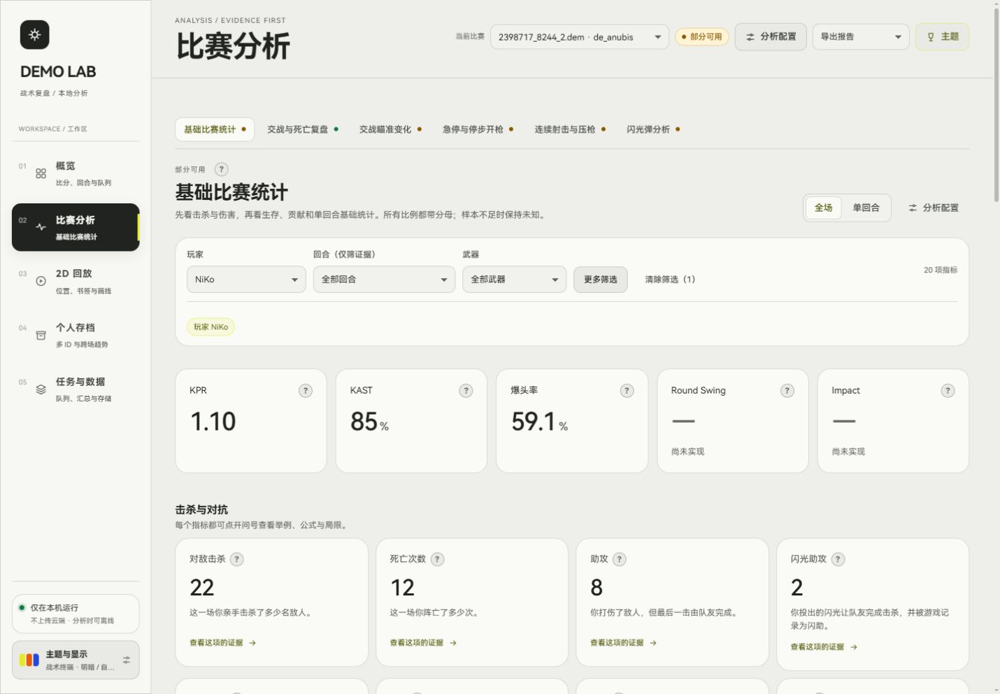

> 更新：当前静态外观、对位、多杀与残局，以及 Impact 移除说明见 [STATIC_MATCH_HIGHLIGHTS.md](STATIC_MATCH_HIGHLIGHTS.md)。下文保留历史版本记录。

# Glass UI and local fonts — 2026-10-28

Follow-up: see [UI polish and experimental scores](UI_POLISH_AND_SCORES.md) for the newer list/card switch and implemented experimental Round Swing/Impact. The placeholder status below describes the earlier revision.

This revision takes the supplied dashboard prompt as a visual reference for soft surfaces, rounded cards, restrained translucency and clear typography. The existing CS2 application, data contracts and navigation remain functional.

## Included changes

- HarmonyOS Sans SC Regular, Medium and Bold are bundled as original, unmodified TTF files in `frontend/public/fonts/harmonyos/`. The production build copies them into `frontend/dist/fonts/harmonyos/`. No font CDN or operating-system installation is required.
- The original Huawei license is included alongside the fonts. The application footer links to it and displays the font usage notice. Copyright belongs to Huawei; do not replace its license or distribute modified fonts under the same terms without checking the license.
- Page gridlines are removed. Cards, navigation, controls and typography use softer spacing, radii and shadows.
- Theme settings retain all existing palettes, custom colors, light/dark modes, reduced motion and optional information controls.
- Open **主题 → 背景图片** to select a JPG, PNG or WebP (up to 12 MB and 40 million pixels). Strength and blur are adjustable. **移除背景图片** returns to the plain theme background.
- Background images and their settings are saved in IndexedDB in the current browser origin. They are not sent to the backend, included in exports or copied into the source package. Changing browser, hostname or port uses separate storage. Clearing site data removes the saved image. The general appearance reset and background removal are separate controls.
- The basic-statistics player summary shows KPR, KAST and 爆头率. KPR/KAST/K/D/DPR explanations live in question-mark popovers. The former large K/D core card is removed.
- Round Swing and Impact currently show **— / 尚未实现** with explanations. They are display placeholders, not implemented backend metrics and not numeric fields in exports. No Rating is generated.

## Rating decision

HLTV's [Rating 3.0 introduction](https://www.hltv.org/news/42485/introducing-rating-30) describes replacing the old Impact component with Round Swing and Multi-Kill. Its [October 2026 accuracy update](https://www.hltv.org/news/45596/rating-30-receives-small-accuracy-improvements) describes trained and calibrated win-probability models. Those articles do not supply a complete reproducible model for this application. This revision therefore does not invent an official-equivalent Rating, Round Swing or Impact score. KAST continues to use the existing documented local rules.

## Validation

- TypeScript check and Vite production build passed.
- Existing Python suite: **160 passed**; one upstream Starlette/httpx deprecation warning.
- Real local report: NiKo KPR **1.10**, KAST **85%**, 爆头率 **59.1%** displayed; unimplemented scores shown as dashes.
- Browser checks: select a local test PNG, adjust blur, refresh and confirm retained image, then remove the test image successfully.
- Desktop 1440×1000 and narrow 390×844 layouts inspected, including dark mode; no page-level horizontal overflow at those widths.
- Embedded font URLs, font CSS, original license and source archive entries are checked during delivery.

## Build and handoff

Run `setup.cmd` once to install the locked dependencies, then `start.cmd`. This remains a source handoff; it is not a standalone executable release. The archive includes the compiled frontend and fonts but excludes virtual environments, demos, analysis databases and browser wallpaper data.

Implementation: `frontend/src/theme/Background.tsx`, `frontend/src/styles/glass.css`, `frontend/src/views/Analysis.tsx`, and `frontend/src/explain/dictionary.ts`.
