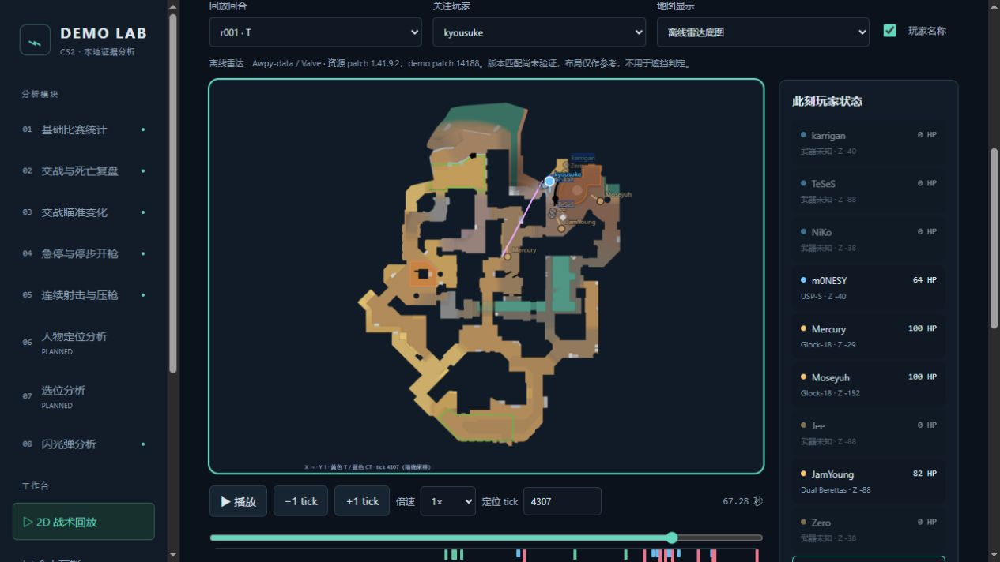

# 本地 2D 回放与片段笔记

入口：工作台 → 2D 战术回放。现有完成任务可直接使用，无需重跑；新加入的闪光事件需要使用包含它们的新事实结果。

## 已实现

- 按回合读取真实玩家位置、朝向、生命、存活状态、武器；T/CT 颜色以当前 tick 阵营为准。
- 本地雷达底图、世界坐标图切换；支持本地 PNG/JPEG/WebP 图片与世界边界校准。
- 播放、暂停、0.25×—4×、逐 tick、数值 tick、拖动时间轴与事件定位。
- 事件轨道包含事实已有的击杀、伤害、致盲、闪光爆开、投掷、炸弹事件。事件不跟随玩家位置降采样。
- 点击分析证据可通过 `ReplayFocus` 跳转回合、tick 并关注玩家。
- 片段标题、备注、世界坐标自由画线和撤销；收藏按 demo SHA256 存本机，重跑任务共享。
- 书签移除进入回收记录，可通过界面恢复。数据位于 `data/replay/<demo_hash>.json`，与原始录像和算法结果分开。
- 新任务 / 回合异步响应使用取消标记，精确帧请求使用递增代号；旧响应不会覆盖新选择。书签写入响应也检查当前任务。

## 时间与查询约束

预览默认每 8 tick 取一帧；长回合自适应，约最多 1601 帧。一次上限 100000 tick / 32020 玩家状态 / 5000 事件，超限要求缩短时间范围。DuckDB 只选择回放字段并过滤当前回合，不在浏览器载入整场高频表。每个查询独立连接，256 MiB / 2 threads。主结果通过共享 mtime/size LRU 读取。

播放速度使用该 demo 校验后的 `tick_seconds`，没有可信尺度时不能播放。回放保持最近一个已观测采样，不插值；间隙超出本次采样间隔时不继续画旧状态。暂停/定位后防抖 160 ms 查询精确 tick，底部标记“精确采样”；不存在的 tick 不伪造状态。事件发生在 tick 内，状态为 tick 末，不能当作玩家实际屏幕或 subtick 状态。

## 地图资源与限制

离线资源来自 [Awpy-data release 2000935](https://github.com/pnxenopoulos/awpy-data/releases/tag/2000935)，图像与变换表为同一发布。`images.zip` 2,876,805 bytes，SHA256 `217dec0b1f2203cc7e9f7bb1b9ef13873665f093203a7df7231b9eb0074b649e`，下载后已与发布 manifest 核对。20 张 PNG（含下层）均为 1024×1024；源码与发行包包含 `frontend/public/maps/NOTICE.txt`、发布 manifest 和坐标表。

图像及 overview 数据版权归 Valve Corporation，Awpy-data 的 MIT 仅覆盖构建脚本，不覆盖游戏素材。没有声称 Valve 背书。参见资源目录 NOTICE 与[上游说明](https://github.com/pnxenopoulos/awpy-data#licensing)。

坐标：`pixelX=(X-pos_x)/scale`，`pixelY=(pos_y-Y)/scale`。Anubis：`pos_x=-2796, pos_y=3328, scale=5.22`。楼层仅使用发布 overview 的 `verticalsections` 或用户手动 Z 分界；Anubis 没有此分界，不编造上下层。

资源 patch 1.41.9.2，本次真实 demo patch 14188，**没有验证地图版本完全匹配**。界面始终显示这一限制；底图仅用于视觉参考，不能计算可见性。旧版地图可以导入本地图片并校准边界。自定义校准仅保存在当前浏览器 `localStorage`，不会混入算法结果；地图左右须为 X 增加方向、上下须为 Y 减少方向，图片留白也计入校准范围。

没有弹体事实时不绘制推测的投掷飞行路线；炸弹/投掷事件仍出现在时间轴。当前没有烟雾体积、碰撞遮挡、第一人称画面与音频复现。

## 接口

- `GET /api/jobs/{jid}/replay/meta`
- `GET /api/jobs/{jid}/replay/frames?round_id=r001&start=...&end=...&step=8`
- `GET /api/jobs/{jid}/replay/bookmarks`
- `POST /api/jobs/{jid}/replay/bookmarks`：round_id、tick、可选 end_tick / player_id、title、note、lines（世界坐标点数组）。
- `DELETE /api/jobs/{jid}/replay/bookmarks/{id}`：软删除。
- `POST /api/jobs/{jid}/replay/bookmarks/{id}/restore`：恢复。

组件：`Replay({jobId, focus?, onSelectPlayer?})`，focus 为 `{tick, round_id?, player_id?, nonce?}`；相同 tick 再跳转可增加 nonce。路由不接受客户端文件路径，事实路径限制在应用 `data/facts`，书签文件名只使用已验证 demo hash。标题/备注作为 React 文本显示，不执行 HTML。

## 验收

`pytest app/tests/test_replay.py -q`：4 项通过，覆盖范围裁剪、精确 tick、事件未降采样、非法回合/路径、书签校验与恢复。前端 TypeScript/Vite 构建通过。

真实 job `54139e65fa594071b8c1c35f16d1f730`：20 回合，首回合 6390 玩家状态 / 36 事件 / step 8；单次本机 meta 1.56 秒、frames 0.247 秒（仅一次观测，不是性能基准）。界面验证地图和玩家位置、4306→4307 单 tick、关注玩家、世界坐标切换、刷新后书签恢复、自由绘图和备注保存。绘图测试发现并修复 React 指针事件延后读取 currentTarget 的异常，复测无新错误。

图中紫线是测试手绘，不代表真实移动或建议路线；应用里保留两个明确标为“验收示例”的书签，可移入回收记录。
