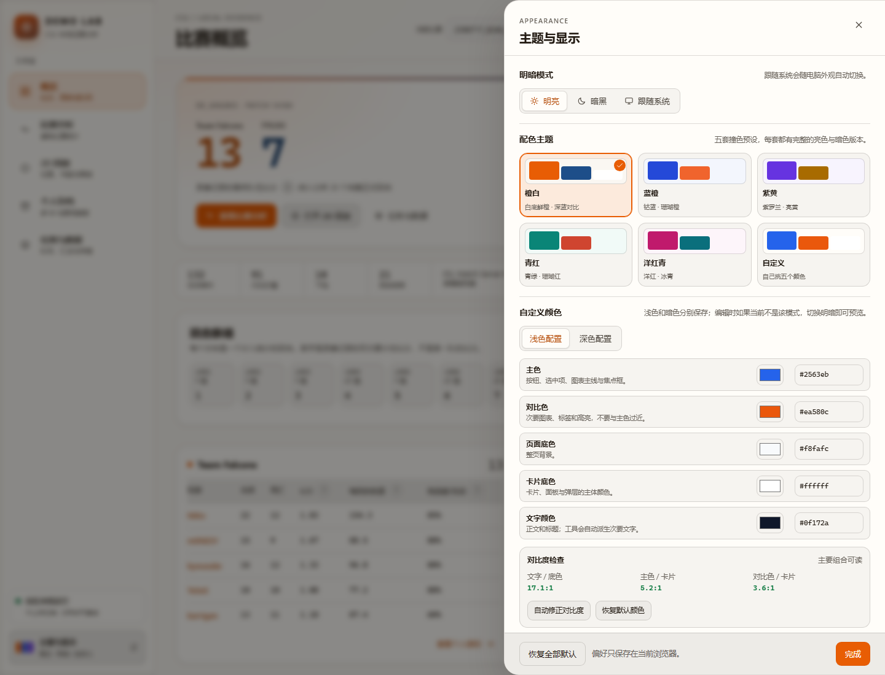
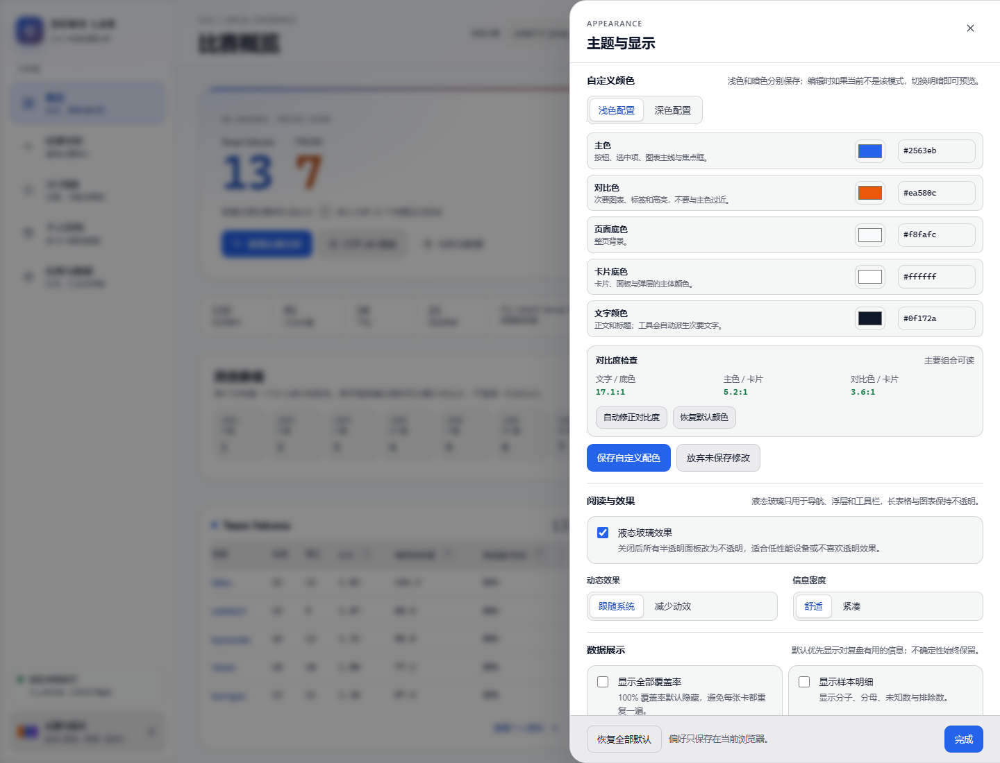
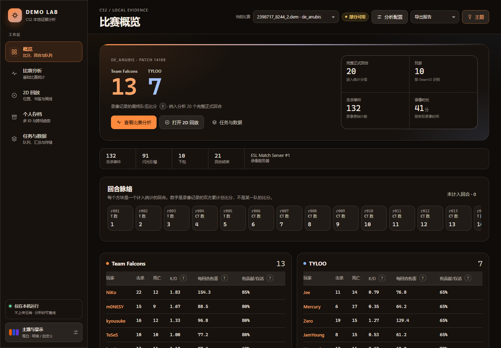

# 界面外观与主题系统（2026-10-27 重设计）

完整设计说明见 [UI_REDESIGN.md](UI_REDESIGN.md)，验证记录见 [UI_REDESIGN_VALIDATION.md](UI_REDESIGN_VALIDATION.md)。

## 快速说明

导航底部的“主题与显示”和顶栏“主题”打开同一个设置面板。明暗模式（明亮 / 暗黑 / 跟随系统）与配色主题（橙白 / 蓝橙 / 紫黄 / 青红 / 洋红青 / 自定义）独立保存。

- 偏好键：demo-lab.appearance.v2，兼容 demo-lab.appearance.v1。
- 自定义颜色：主色、对比色、页面底色、卡片底色、文字颜色；浅色/深色分开保存。
- 对比度检查与自动修正；非法颜色不应用。
- 液态玻璃开关；关闭或不支持 backdrop-filter 时不透明回退。
- 减少动效；跟随系统 prefers-reduced-motion。
- 舒适/紧凑密度；全部覆盖率、样本明细、方法说明、质量标签、技术信息、模块状态六个显示开关。

## 设计 token

- frontend/src/theme/tokens.css：五套配色的核心色、明暗语义色、圆角、阴影、玻璃、图表与状态色。
- frontend/src/theme/appearance.tsx：读取/迁移偏好、系统主题监听、自定义颜色派生、对比度计算与自动修正。
- frontend/src/explain/：指标词典、三层解释浮层。
- frontend/src/ui/：统一按钮、标签、弹窗、分段选择、覆盖率等原语。
- frontend/src/styles/：基础样式、页面布局和响应式规则。

组件应引用语义 token，不要写死明暗颜色。新增主题时在 tokens.css 增加一组核心色，并在 frontend/src/theme/appearance.tsx 的 PALETTES 中登记名称和预览色；新增指标时在 explain/dictionary.ts 增加通俗名称、一句话、举例、不能说明什么，公式继续读取后端定义。

## 截图

