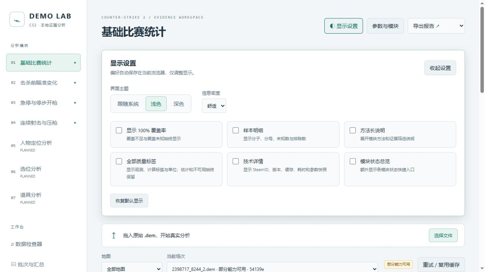
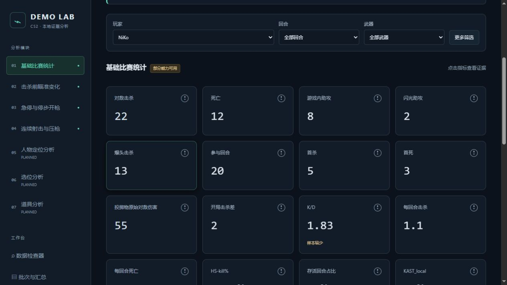

# 界面外观与信息精简（2026-10-24）

右上角“显示设置”可选浅色、深色或跟随系统（默认），以及舒适或紧凑密度。偏好自动保存在当前浏览器的 `demo-lab.appearance.v1`；“恢复默认显示”重置所有外观选项。其他浏览器和合作伙伴首次打开均使用默认值。

## 默认显示

- 表格与个人指标卡仅显示非 100% 或未知覆盖率。开关可恢复所有覆盖率。
- 覆盖率为空时显示“覆盖率未知”；低于 100% 但舍入会到 100% 时显示“<100%”，不会冒充全覆盖。
- 估计、不可用、小样本、失败及旧版结果提示保留。指标旁的说明按钮始终可用。
- 样本明细、方法长说明、全部质量标签、技术详情、模块状态总览各有独立开关，默认关闭。
- 玩家、回合、武器直接显示；阵营、姿态、距离和判定收进“更多筛选”。收起时明确清除这组筛选，避免隐藏的筛选继续影响结果。
- 已有结果时缩小导入区域。证据弹窗的原始 JSON 默认折叠，可以随时展开。

外观改动只影响交互页面，不修改算法、任务缓存、指标分母或导出文件，无需重新解析 demo。

## 合作伙伴维护入口

- `frontend/src/appearance.tsx`：带输入校验的显示偏好、设置面板、覆盖率显示组件。
- `frontend/src/theme.css`：明暗主题共用的语义颜色变量；新模块图表也应引用变量。
- `frontend/src/style.css`：布局、组件和密度样式。
- `frontend/index.html`：首次绘制前应用主题，减少刷新时的明暗闪烁。

## 验收

TypeScript 检查和 Vite 生产构建通过。在真实任务 `54139e65fa594071b8c1c35f16d1f730` 浏览器验证：

- 基础统计的 190 个全覆盖标签默认隐藏，开关开启后恢复 190 个；覆盖不足仍显示。
- NiKo 的 20 张基础卡仅显示一处覆盖不足（80.6%），急停卡保留 78.7% 覆盖和“估计 / 待校准”。
- 样本明细开关显示急停分子 / 分母 29 / 37、未知 10、排除 229；其他说明、技术和模块状态开关正常。
- 浅色、深色、紧凑显示正常，刷新后浅色及紧凑偏好保留；恢复默认正常。
- 浅色证据抽屉、地速图表和折叠 JSON 正常；检查时浏览器无 console error。
- 1280px 视口页面无横向溢出，宽表格在容器内滚动。本次仅改前端，未重跑后端解析。

