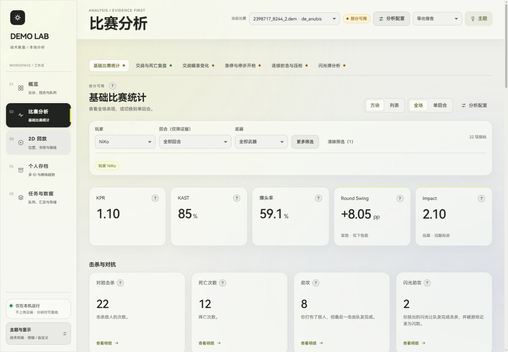
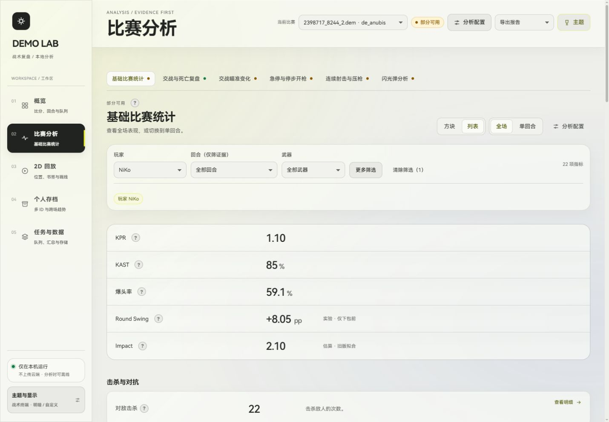

> 更新：当前静态外观、对位、多杀与残局，以及 Impact 移除说明见 [STATIC_MATCH_HIGHLIGHTS.md](STATIC_MATCH_HIGHLIGHTS.md)。下文保留历史版本记录。

# 界面与实验指标更新

2026-10-28。此文替代 GLASS_UI.md 中关于 Round Swing、Impact 尚未实现的说明。

## 界面

- 比赛分析右上方增加「方块 / 列表」，选择会保留到下次打开；全场与单回合共用此偏好。
- 方块采用统一的标题、数值、说明、明细入口顺序。同组卡片等高，明细入口对齐底部；长内容可扩展，不裁掉数据。
- 列表按行展示同一份指标，数据和筛选口径不变。
- 问号默认显示一句解释。爆头率为「爆头击杀 ÷ 总击杀」。例子、公式和限制收在「公式与补充说明」内；估算指标仍标注估算。
- 主题名改为橙色、蓝色、紫色、青色、洋红色；选择器只显示文字。保留既有配色值。
- 玻璃效果增强透明度、模糊和边缘高光，增加背景光晕、卡片悬停与按钮反馈。关闭玻璃时面板恢复不透明；减少动效或系统减少动态效果时关闭动画。
- 字体和上传背景功能保留。HarmonyOS Sans 原始文件与许可仍随包分发。

## 指标：basic_stats 1.2.0

### Round Swing：实验，仅下包前

这不是 HLTV Round Swing。这里计算的是**人数模型下的消灭对手概率变化**，不是真实回合胜率。

设己方存活 a 人、敌方 b 人，每次下一场对枪独立且双方胜率均为 50%。

```
P(0, b) = 0
P(a, 0) = 1
P(a, b) = 0.5 P(a−1, b) + 0.5 P(a, b−1)
```

敌方被击杀后，将击杀方概率的增量乘以 100，计给击杀者；受害者扣除同等数值。全场值为可计算参与回合的平均值，单位 `pp/round`（每回合百分点）。5v5 的第一次击杀为 ±13.671875 pp。

- 只使用计分且完整的正式回合，必须能确认开局双方各 5 名存活玩家。
- 下包同 tick 及之后的击杀不计。下包前无对敌击杀的有效回合可以为 0。
- 同 tick 多次死亡、重复死亡、玩家缺失、阵营冲突或攻击者状态不明，整回合不计算，计为未知。
- 自杀、队伤和环境死亡更新人数，不分配个人分数。
- 击杀、死亡的分配总和为 0。不分配伤害、闪光或补枪贡献，也不根据回合最终胜负重新分配。
- 不考虑装备、地图、阵营优势、血量、时间或位置；保枪、经济局及下包后表现不能通过此值评价。

API metric_id 为 `round_swing`，quality 为 `estimated`（无有效回合为 `unknown`），记录有效/未知回合与分母。每个计分事件都有双方人数、击杀方前后概率和个人分值，可从明细定位回放。由于口径更窄，禁止将它当作 HLTV 对照指标或用其构造官方 Rating。

### Impact：旧版拟合

```
Impact ≈ 2.13 × KPR + 0.42 × APR − 0.41
```

APR 使用本工具记录的游戏助攻 / 参与回合。公式来自 [Dave 2021 年的原始拟合研究](https://dave.xn--tckwe/posts/reverse-engineering-hltv-rating/)，不是官方公布公式，也未在现代 CS2 上重新校准。允许负数，不擅自截断；没有参与回合时返回 null。跨场按参与回合加权，可从 numerator / denominator 重算。

HLTV [Rating 3.0](https://www.hltv.org/news/42485/introducing-rating-30) 已用 Round Swing 和 Multi-Kill 替代旧 Impact。这里保留旧版估算只供实验查看，仍不生成 Rating。

## 使用与验证

旧报告不会被改写。点击「用当前版本重算」后才有新指标；重算创建新任务并复用已有事实缓存。

- TypeScript 与 Vite 生产构建通过。
- Python 测试 171 项通过，覆盖概率对称性、积分守恒、下包边界、同 tick 死亡、状态冲突、世界伤害、无分母、跨回合聚合及证据契约。
- 原 demo 全模块重算完成：任务 `d3a866362642463fbbd3f64512cd9b56`，基础统计 1.2.0。NiKo 的 KPR 1.10、KAST 85%、爆头率 59.1%、Impact 2.101、Round Swing 8.046875 pp/回合（20/20 可计算）。这些数值用于验证实现，并非验证估算模型的预测准确率。
- 桌面与窄屏实测切换、列表偏好保留、短说明、纯文字主题、玻璃关闭、减少动效。





主要文件：`frontend/src/views/Analysis.tsx`、`frontend/src/styles/glass.css`、`frontend/src/explain/MetricExplain.tsx`、`backend/modules/basic_stats/experimental.py`。无需新增依赖。
