# CS2 Demo Lab 前端重设计（2026-10-27）

本轮在原有 React + TypeScript + Vite 技术栈内重做界面，不修改后端统计公式、回合计分规则、数据契约或数据库。所有页面仍然读取真实本地接口；没有用虚构数据替代任何未实现能力。

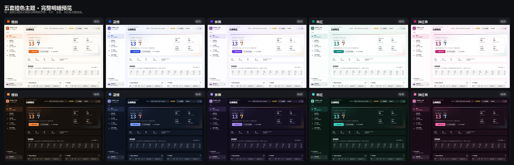

## 1. 设计目标

- 让第一次使用的玩家先看懂“这场比赛发生了什么”，再逐步进入证据。
- 主次分明：比赛概览、个人表现、单回合、问题复盘各有独立层级，不再把所有内容堆成等权卡片。
- 每个核心数字都有三层解释：一句话、举例与边界、计算细节。
- 未知、零样本、部分可用、旧结果、失败和取消都有明确状态，不显示成 0 或负面评价。
- 离线优先：系统字体、内联 SVG 图标，无在线 CDN、在线 AI 或第三方分析服务。
- 明亮/暗黑/跟随系统与五套撞色主题分开控制，并提供可保存的自定义颜色。

## 2. 信息架构

主导航固定为五个工作区：

| 工作区 | 内容 |
| --- | --- |
| 概览 | 录像比分、纳入回合、回合脉络、队伍与玩家摘要、模块状态、最近任务、导入入口 |
| 比赛分析 | 模块切换、全场/单回合、筛选、指标分组、证据索引、指标解释 |
| 2D 回放 | 原有位置回放、事件、书签、画线、底图校准 |
| 个人存档 | 多 SteamID 档案、趋势、快照、复盘情形、导出 |
| 任务与数据 | 队列、多场汇总、本地存储、开发者数据检查 |

分析页内部用横向模块轨道切换六个已实现模块：基础比赛统计、交战与死亡复盘、交战瞄准变化、急停与停步开枪、连续射击与压枪、闪光弹分析。人物定位与选位仍只出现在“开发计划”折叠区，并明确标注未实现、不会产生结果。

## 3. 视觉系统

### 3.1 五套撞色主题

每套主题分别定义明亮与暗黑的核心色，再通过 color-mix 派生卡片、边框、弱化文字、软背景和图表色。

| 主题 | 明亮主色 | 明亮对比色 | 暗黑主色 | 暗黑对比色 |
| --- | --- | --- | --- | --- |
| 橙白 | #e85d04 | #1d4e89 | #ff8a3d | #8ab4ff |
| 蓝橙 | #2449d8 | #f0642d | #7f9dff | #ff8b60 |
| 紫黄 | #6633e0 | #b8860b | #a78bff | #ffd34d |
| 青红 | #0a8577 | #cf4530 | #3fd6c4 | #ff8a70 |
| 洋红青 | #c01a6c | #0a6f7c | #ff6aac | #64e3ef |

暗黑紫黄、洋红青等主题使用更亮的对比色保证识别；明亮紫黄的对比色使用金色而不是纯亮黄，以保证图表线和文字对比度。成功、警告、失败、信息四种语义色不随配色变化，避免把失败伪装成成功。

### 3.2 明暗与跟随系统

主题偏好保存在当前浏览器，键为 demo-lab.appearance.v2，并兼容旧的 demo-lab.appearance.v1 中的明暗、密度和显示开关。首次绘制前由 index.html 应用主题，减少刷新闪烁。跟随系统监听 prefers-color-scheme 变化；测试中通过 Chrome 媒体模拟验证了 dark / light 自动切换。

### 3.3 自定义颜色

自定义支持五个颜色：主色、对比色、页面底色、卡片底色、文字颜色。浅色和深色配置分别保存，切换明暗不会丢失。编辑时实时预览；非法十六进制值不应用并显示错误；保存按钮只在全部合法时可用。对比度检查显示文字/底色、主色/卡片、对比色/卡片的比值，低于阈值给出说明和“自动修正对比度”。点击“恢复全部默认”会同时恢复主题、效果和显示开关。

### 3.4 液态玻璃、圆角与动效

- 玻璃只用于侧边导航、顶栏、解释浮层、设置面板和证据弹窗；长表格、图表和正文保持不透明。
- “液态玻璃效果”开关关闭后，导航、顶栏、浮层改为不透明；不支持 backdrop-filter 的浏览器自动使用不透明回退。
- 圆角分层：控件 9px、小卡片 13px、大面板 18px、外层容器 24px、状态标签使用胶囊形。
- 动效只有短过渡、弹层淡入和抽屉滑入。跟随系统或手动“减少动效”都会关闭动画和过渡，尊重 prefers-reduced-motion。
- 页面背景使用极低透明度的主色/对比色径向渐变，不使用持续动画或整页高强度模糊。

### 3.5 字体与图标

使用系统字体栈（Inter、Segoe UI、Microsoft YaHei UI、system-ui），数字使用等宽字体和 tabular-nums。所有图标为内联 SVG，不依赖在线图标库。构建产物不请求外部资源。

## 4. 数据解释

### 4.1 三层说明

每个可见指标旁的问号按钮可悬停、键盘聚焦或触摸点击打开，内容包括：

1. 一句话：这个数字在说什么。
2. 举例 + 不能说明什么：用带“举例”标签的简单情景说明，并明确不能据此判断什么。
3. 计算细节：公式、纳入/排除、分母与样本单位、未知/排除数量、当前参数和已知局限。

计算细节读取后端 metric_definitions，避免前端另写一套公式。指标名称、通俗说明、举例和边界集中在 frontend/src/explain/dictionary.ts；覆盖 53 个指标和术语表。

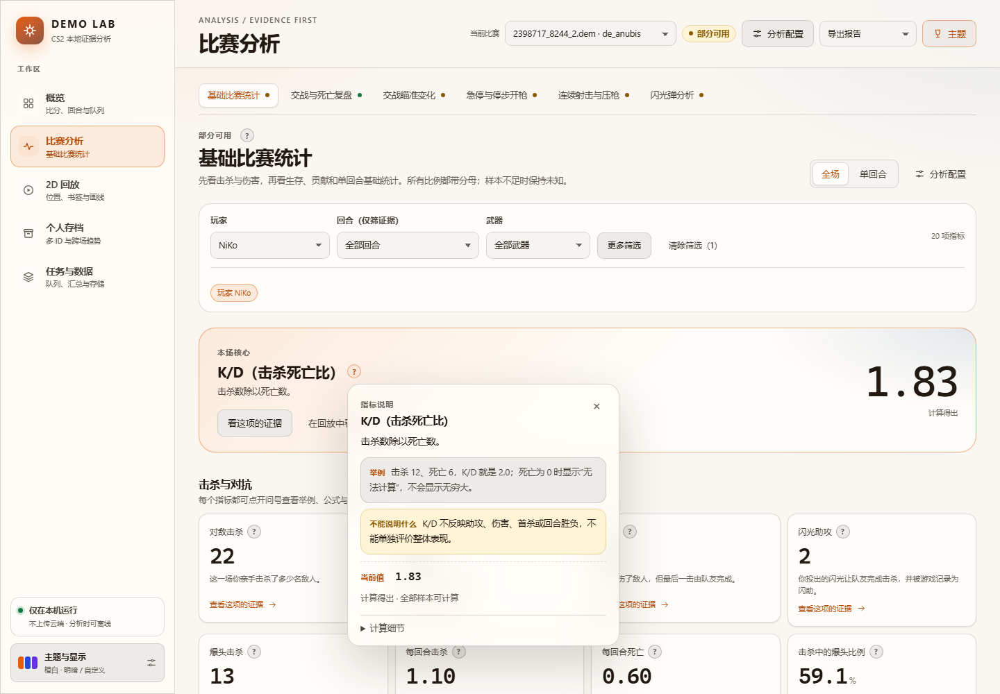

### 4.2 未知与零值

- value 为 null 时显示“—”，不显示 0。
- 分母为 0 时说明“没有符合条件的样本”，不显示 0%。
- 有未知数时说明“这一项暂不计算”，不按 0 处理。
- 覆盖率 100% 默认隐藏；非 100% 显示可核实比例并附覆盖率解释；用户可开启“显示全部覆盖率”。
- 覆盖率为 0 但存在估计值时，额外说明“暂无样本能完全核实，数值不应当作确切结果”。
- 质量标签中“估计值”和“暂不可用”始终显示；只有开启“显示全部质量标签”时才显示“计算得出/观测事实”。

### 4.3 单回合与全场

基础比赛统计接入真实 GET /api/jobs/{job_id}/round-stats?round_id=... 接口：

- 单回合表展示 10 名玩家的击杀、死亡、助攻、K/D、KAST、本回合伤害、有效伤害与爆头。
- 单回合 KAST 使用“是/否”，个人卡片中存活使用“存活/阵亡”，避免把 0/1 误读成百分比。
- 单回合伤害就是该回合记录的伤害；单回合比例不平均成全场比例。
- 其他尚无单回合聚合的模块禁用“单回合”，或显示明确提示“这个模块目前只有全场统计”，不会把全场值伪装成本回合。
- 旧结果没有 round-stats 时接口返回 409，页面显示可操作提示：“按当前版本重新分析 / 检查模块设置”，并解释事实缓存会复用。
- 旧模块版本结果另有黄色提示，直接提供“用当前版本重算”。

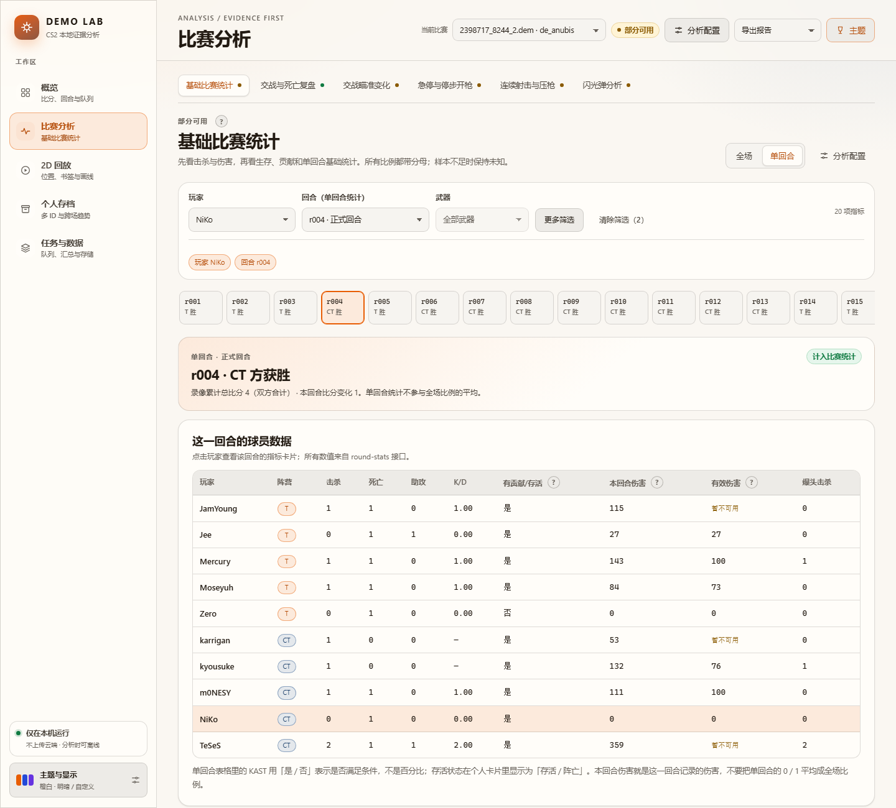

## 5. 主要页面

### 5.1 概览

- 大比分明确标注为“录像记录的最终队伍比分”，不宣称是分析重算比分；同时显示纳入分析的完整正式回合数。
- 回合脉络使用录像累计总比分（双方合计）并注明口径；未计入回合可展开查看原因。
- 队伍与玩家摘要：击杀、死亡、K/D、每回合原始伤害、有贡献/存活，均来自真实基础统计指标。
- 模块状态直接显示“部分可用”并附解释；规划能力折叠在开发计划中。
- 明确的“可以回答 / 不能回答”边界卡片。
- 顶栏保留比赛选择与地图筛选（仅有一个地图时自动隐藏地图下拉）；上传、队列、取消、重试、导出入口保留。

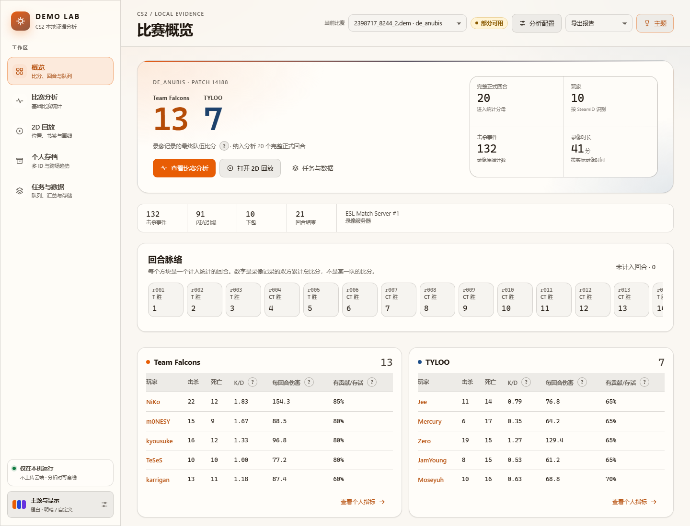

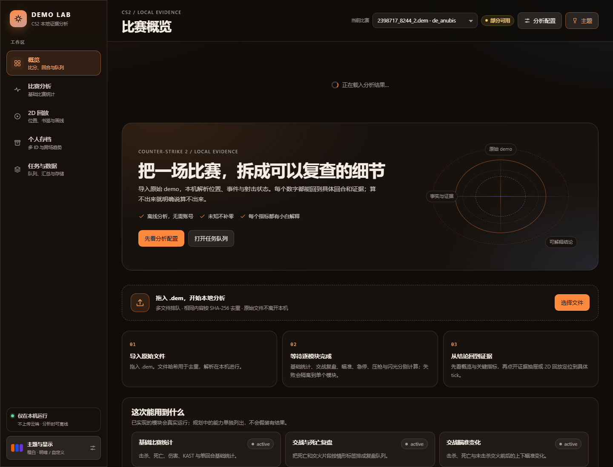

完整页面：

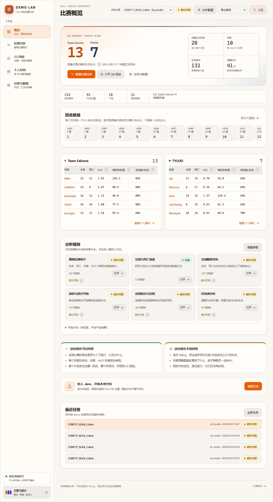

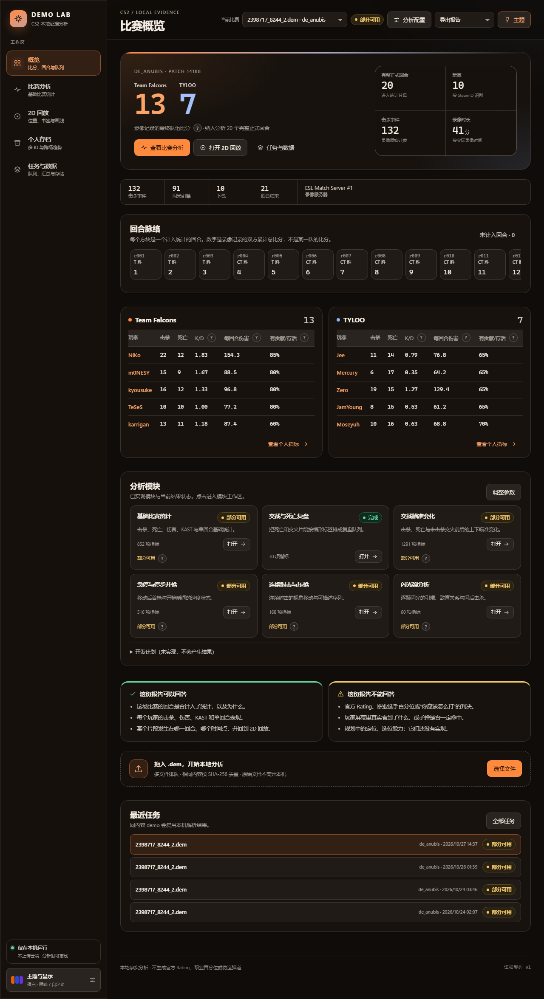

### 5.2 分析

- 顶部模块轨道显示各模块状态点。
- 筛选区分为玩家、回合、武器和“更多筛选”（阵营、姿态、距离、判定），当前筛选以可读标签列出，一键清除。
- 核心指标不是平均铺开：K/D 等本场核心先给出大字号摘要，再按“击杀与对抗 / 开局 / 生存与贡献 / 伤害与细节”分组。
- 无玩家时先显示玩家指标表，点击名字进入个人视图；表格可横向滚动，首列固定。
- 证据索引使用通俗描述，原始判定依据与完整 JSON 放在证据详情里；分页与筛选不会重算上方指标。

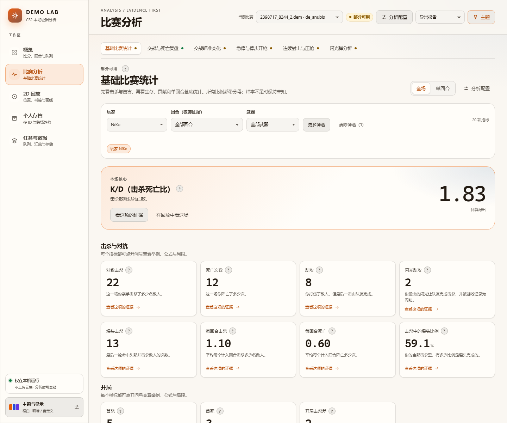

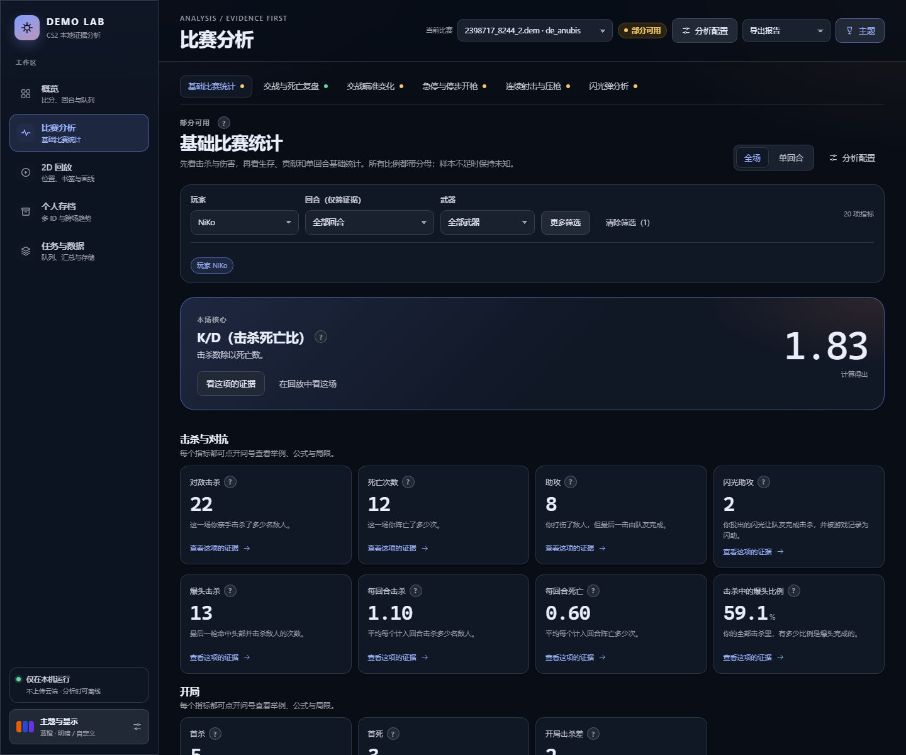

### 5.3 证据详情与图表

证据弹窗优先显示图表，再显示逐弹/逐事件表格；缺失样本不补零、不跨片段连线。技术判定依据和完整 JSON 默认折叠。

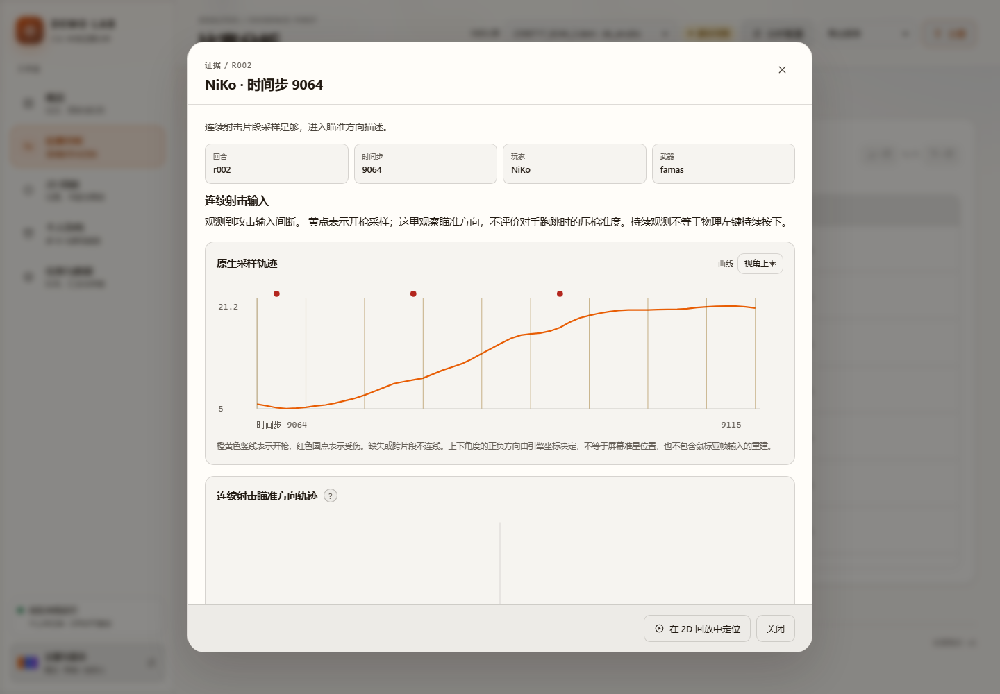

### 5.4 回放、存档与任务

原有 2D 回放、书签、画线、个人存档、多场汇总、存储清理和数据检查功能全部保留，并统一到新 token。回放地图保留为深色媒体舞台，避免雷达图在浅色背景上失真；周围控件、名册和事件列表跟随主题。

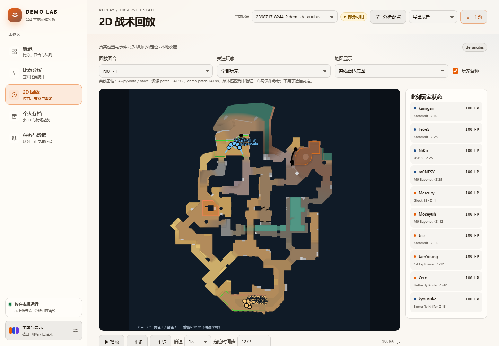

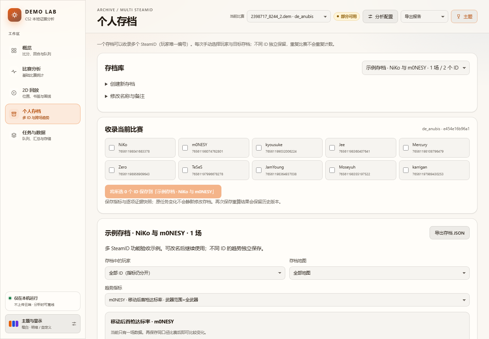

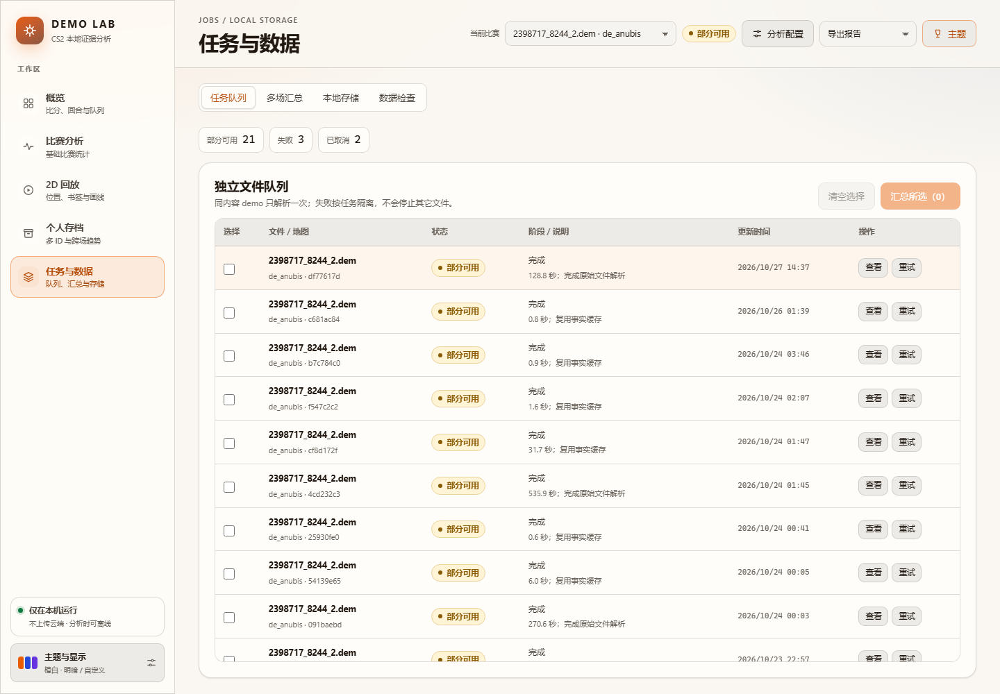

### 5.5 状态覆盖

已处理并验证：加载、排队、运行、部分可用、失败、取消、无数据、未选择玩家、旧结果需要重算、HTTP 409、上传被拒绝、筛选为空。

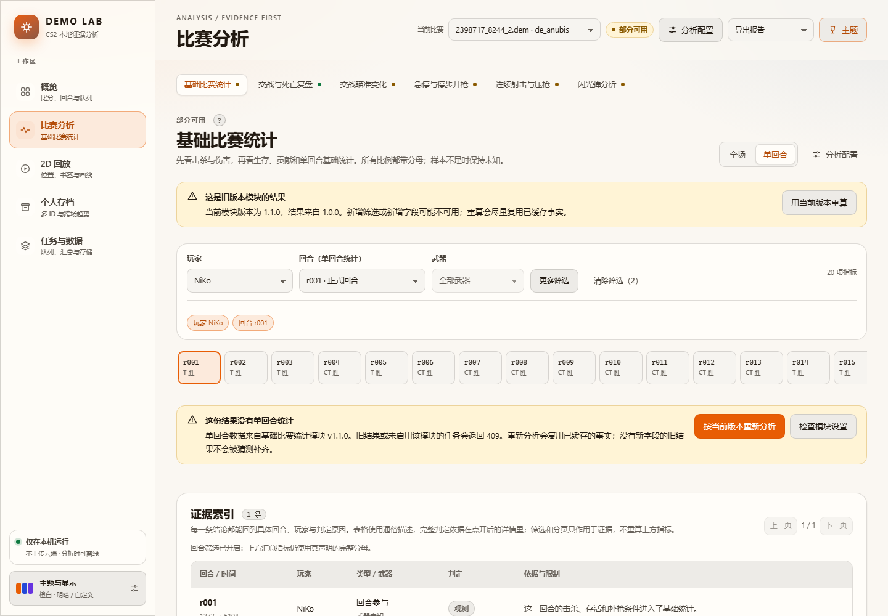

## 6. 响应式与可访问性

- 1440、1280 与 390 像素宽度已验证。
- 900px 以下侧边栏变为顶部横向导航；主题按钮始终可见，导航自身横向滚动。
- 390px 下“当前比赛”选择器独占一行，主要操作按钮不裁切；页面无横向溢出。
- 宽表格在自身容器内滚动，并通过 tabIndex 支持键盘滚动；移动端显示“左右滑动表格”提示。
- 弹窗有焦点陷阱、Esc 关闭和焦点返回；解释浮层支持悬停、键盘焦点、触摸点击、Esc 关闭。
- 焦点样式统一为 2px 主色轮廓；橙色主按钮使用深色文字，对比度约 5.4:1。
- 减少动效、减少透明效果、系统主题均有独立开关；不支持 backdrop-filter 时回退为不透明。

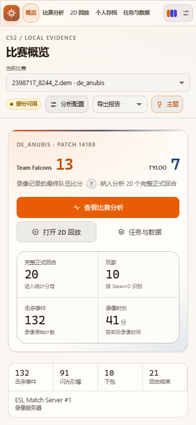

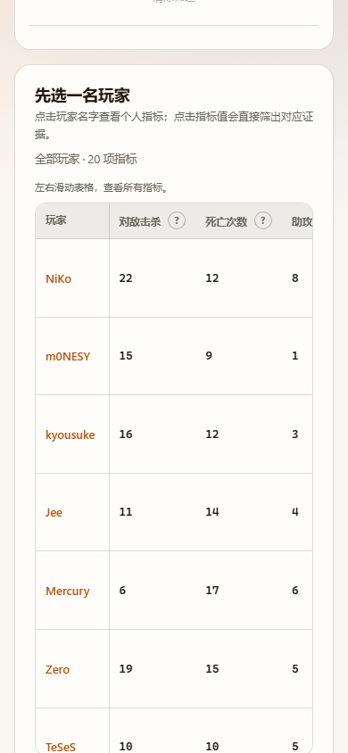

## 7. 实现结构

主要新增或重构文件：

    frontend/index.html                 首屏主题与旧偏好兼容
    frontend/src/main.tsx               入口
    frontend/src/app/App.tsx            应用状态、任务、上传、路由
    frontend/src/app/api.ts             统一请求与上传进度
    frontend/src/app/chrome.tsx         导航、顶栏、设置面板、参数面板
    frontend/src/app/format.ts          指标格式化、证据通俗描述
    frontend/src/theme/tokens.css       设计 token、五套配色、语义色
    frontend/src/theme/appearance.tsx   明暗/跟随系统/自定义/持久化
    frontend/src/explain/               指标词典与三层解释组件
    frontend/src/ui/                    Icon、Badge、Modal、Segmented 等
    frontend/src/views/                 Overview、Analysis、Jobs、EvidenceDetail
    frontend/src/styles/                base、app、响应式样式
    frontend/src/Replay.tsx 等           保留功能，重写样式并本地化术语

旧的 theme.css 与 style.css 已移除；组件样式按页面拆分，统一引用 token。

## 8. 接口与边界

本轮没有修改后端代码、接口、统计公式或数据库。页面实际使用的接口包括：

    GET  /api/modules
    GET  /api/jobs
    POST /api/upload
    POST /api/jobs/{id}/cancel
    POST /api/jobs/{id}/retry
    GET  /api/jobs/{id}/result
    GET  /api/jobs/{id}/round-stats
    GET  /api/jobs/{id}/evidence/{module}
    GET  /api/jobs/{id}/inspect/{table}
    GET  /api/jobs/{id}/export/{format}
    POST /api/aggregate
    GET  /api/storage
    DELETE /api/uploads/{digest}
    GET/POST /api/profiles 及其条目、历史与导出
    GET/POST/DELETE /api/jobs/{id}/replay/meta|frames|bookmarks
    GET/PUT /api/jobs/{id}/combat-annotations

仍不提供：HLTV Rating、自定义 Rating、职业百分位、真实屏幕还原、未验证的压枪评分、人物定位与选位算法。仅有单个真实 demo 验证，未做跨机器浏览器矩阵和屏幕阅读器实测。

## 9. 验证与文件

构建、后端测试、浏览器断言和截图清单见 UI_REDESIGN_VALIDATION.md。偏好与显示开关说明见 UI_APPEARANCE.md。
